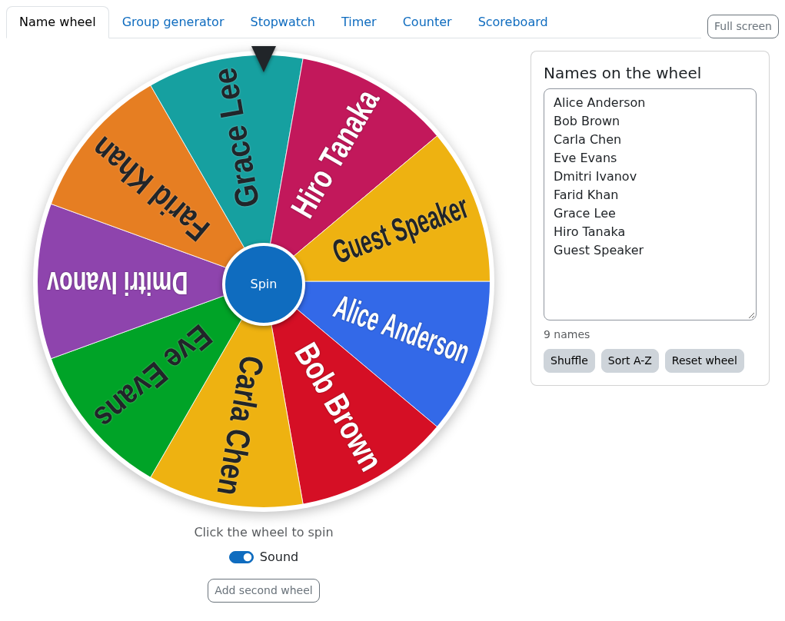
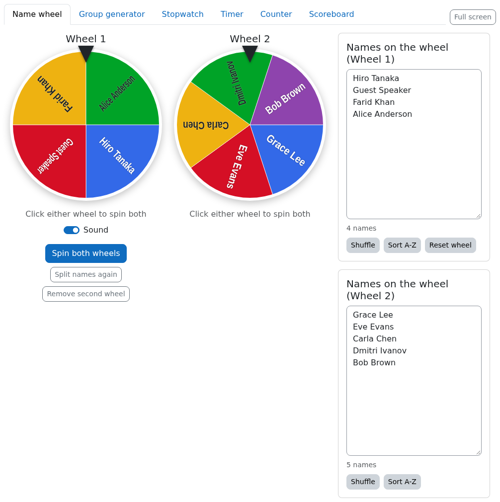
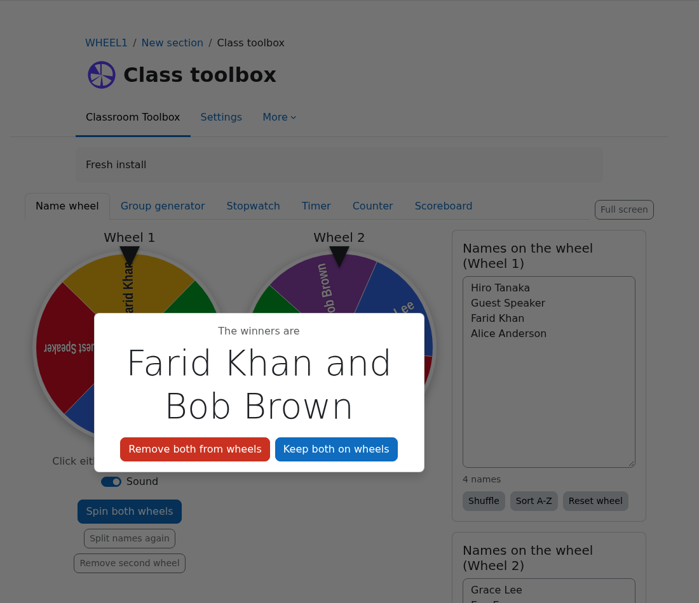
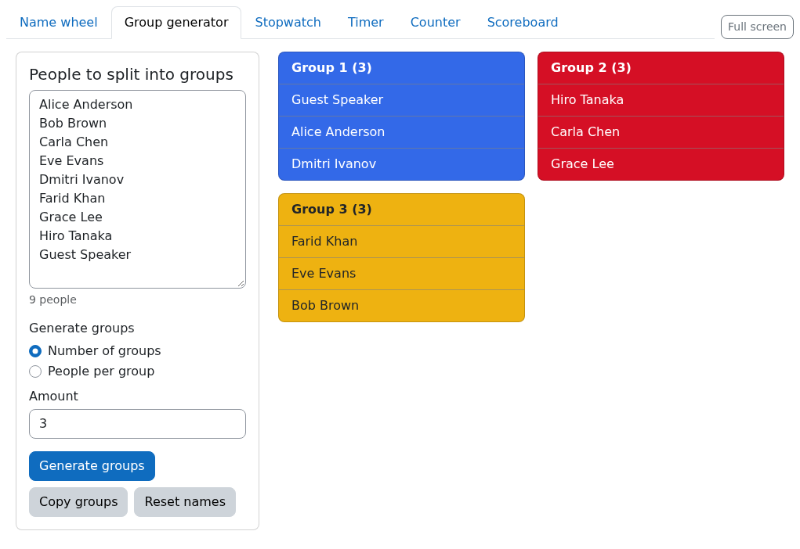
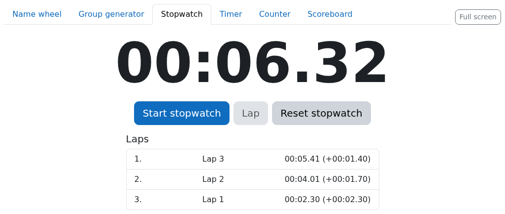
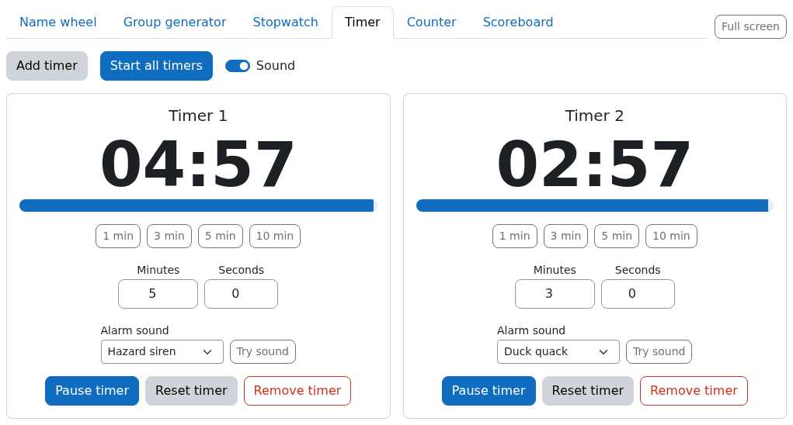
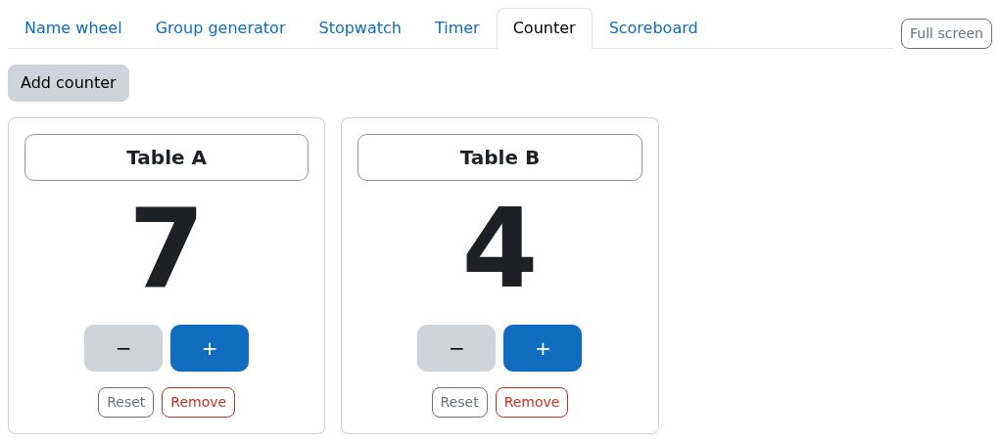
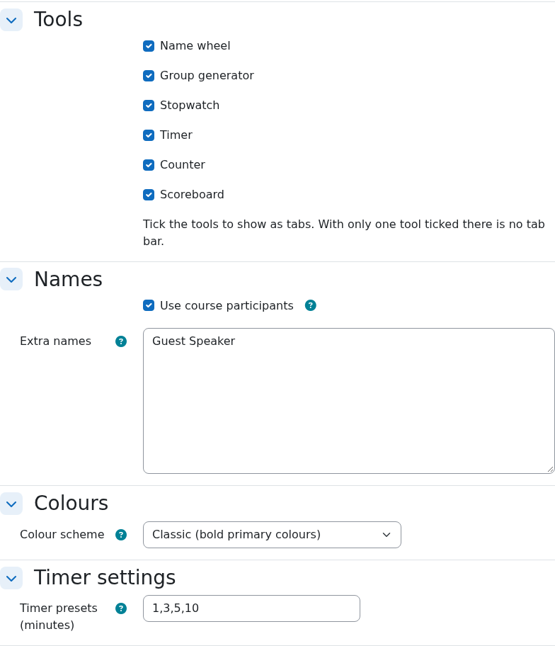

# Classroom Toolbox (mod_classroomtoolbox)

[](https://github.com/billsensei/moodle-mod_classroomtoolbox/actions/workflows/ci.yml)

A Moodle activity with classroom tools shown as tabs, **for the teacher to use on the classroom screen**. Teachers add it once and switch on the tools they want. Students cannot open it, and it does not appear for them on the course page.



## Tools

Each tool is a tab. Teachers choose which tools are on in the activity settings (Tools). With only one tool on, there is no tab bar. Every tool has a **Full screen** button for projecting it onto a classroom screen.

| Tool | What it does |
|---|---|
| **Name wheel** | Spin a wheel of student names; remove the winner or keep them. An **Add second wheel** button splits the names between two wheels and one button spins both, for picking partners. |
| **Group generator** | Split the class into random groups, by number of groups or people per group. |
| **Stopwatch** | Start, stop, lap and reset, with a lap list. |
| **Timer** | Countdown timers with preset buttons, a choice of alarm sound for each timer and a flash at the end, up to four timers at once, and a **Start all timers** button. |
| **Counter** | Up to eight named counters with plus, minus and reset. |
| **Scoreboard** | Teams or names with points, ranked live; the teacher shows it to the class. |



### Name wheel

- **Click the wheel** (or the centre button, or press Enter/Space on it) to spin. A random name is chosen with the browser's crypto random source.
- **Sound**: soft ticks as the wheel passes each name and a chime when one is picked. The **Sound** switch turns it off; the choice is remembered in the browser and also mutes the timer alarm.
- A pop-up announces the winner and offers **Remove from wheel** or **Keep on wheel**.
- The wheel is filled from the course participants (students by default). In group mode, tick any combination of groups to combine them on one wheel. Extra names can be typed in the settings.
- Pick one of five colour schemes (Classic, Ocean, Sunset, Pastel, High contrast); it also colours the group generator's cards.
- The names box beside the wheel can be edited live; **Shuffle**, **Sort A-Z** and **Reset wheel** are available.
- Removing a name only changes the current page; reloading restores the full list.

### Second wheel (on the Name wheel tab)

- **Add second wheel** puts a second wheel beside the first and splits the names between the two at random (with an odd number, one wheel gets the extra name). The wheels are headed Wheel 1 and Wheel 2.
- A single **Spin both wheels** button spins them (clicking either wheel does the same; the buttons in the middle of the wheels are hidden). Wheel 1 starts, and Wheel 2 starts by itself half a second later.
- When both wheels have stopped, one dialog shows both winners together, joined by "and": "Student 1 and Student 2", the first from Wheel 1 and the second from Wheel 2. If either wheel has no names, nothing spins and a message says so.
- Nothing is removed automatically: the teacher chooses **Remove both from wheels** (one name comes off each wheel) or **Keep both on wheels**. Under each wheel a "Picked: ..." line shows its last pick.
- **Split names again** mixes everyone still on a wheel at random; **Remove second wheel** puts all the names back on one wheel and brings back the normal Spin button. Each wheel has its own names box; **Reset wheel** and the group tick boxes work across both wheels.
- While the wheels are spinning, the buttons that change the names (add or remove the second wheel, split again, reset, shuffle, sort and the group tick boxes) wait until they have stopped.
- The second wheel is off each time the page opens, and nothing about it is saved.



### Settings that are remembered

Each tool remembers its settings in the browser, per activity, so they are still there after a reload: the open tab, the groups ticked on the wheels and the group generator, the group generator's amount and mode, the timers, their lengths and their alarm sounds, the counters and their names, and the scoreboard's points per click. Results, running timers, counter values, the names on the wheels and the class list are not saved. **Counter names are saved exactly as the teacher typed them**, so if you name a counter after a student, that name is kept in the browser; on a shared computer, use neutral counter names or clear the browser's site data for this site.

### Group generator



- Starts from the same people as the wheel (course participants you are allowed to see, plus typed names); edit the list freely.
- Choose **Number of groups** or **People per group**, then **Generate groups**. Groups differ in size by at most one person, and the shuffle uses the browser's crypto random source. Each group gets its own colour from the activity's colour scheme.
- In group mode, tick which Moodle groups to include.
- **Copy groups** puts the result on the clipboard as plain text.

### Stopwatch



Start, stop, **Lap** and reset. Time comes from timestamps, so it stays accurate if the tab is in the background.

### Timer



- Preset buttons (set per activity, default 1, 3, 5, 10 minutes), or type minutes and seconds.
- Each timer has an **Alarm sound** dropdown (Hazard siren, Standard beeps, Alarm clock, Klaxon, Futuristic beeps, Duck quack) and a **Try sound** button that plays it even when Sound is off. The choice is remembered per timer. When time is up the chosen sound plays (switch all sounds off with **Sound**) and the card flashes; the end is also announced to screen readers.
- Up to four timers at once. **Start all timers** starts every timer that is not already running. The browser is asked to keep the screen on while a timer runs.

### Counter



Up to eight counters. Rename each one, then raise, lower or reset it.

### Scoreboard


- A teacher adds teams or names (several at once, separated by commas), or copies in the Moodle **groups** or the **participants** with one click. Names are copied as plain text and are **not linked to user accounts**.
- **+** and **−** give or take points; **Points per click** sets the step. You can also type an exact score or rename an entry. **Reset scores** asks first and keeps the entries.
- The board is ranked by points (ties share a place) and re-orders with a short animation. Use **Full screen** to project it.
- The teacher shows the board to the class on the classroom screen; students do not open it themselves. It refreshes itself every few seconds while the tab is open and visible, so a change by a second teacher appears without reloading.
- Who may change it: the capability `mod/classroomtoolbox:managescores` (teachers, non-editing teachers and managers by default). Anyone given `mod/classroomtoolbox:view` without it sees the board read-only.
- Scores are saved in the database, so they survive reloads and are included in backup, restore and duplication. Up to 100 entries per scoreboard. Every change is logged as a `scoreboard_changed` event.

### Accessibility

Every tool is keyboard operable and announces results to screen readers. The wheel prints readable text on every wedge (at least 4.5:1) and offers a 7:1 High contrast scheme. Animations stop for people who ask their system for reduced motion. The scoreboard has a **Pause live updates** switch. An axe-core Behat feature (`tests/behat/accessibility.feature`) checks every tool.

### Privacy

Spins, pairs, groups, laps, timers and counts live only in the open page. The tools' settings (see above) are kept in the browser's own storage on the teacher's computer, not on the server. They never include the class list or the names on the wheels, but counter names are saved as typed, so they could include a name if the teacher types one. The scoreboard stores the labels and points a teacher types in; they are plain text, never tied to a user account, and are removed when the entry or the activity is deleted. The plugin keeps no data linked to a user account, and its privacy provider declares the free text it stores so that it shows in Moodle's privacy registry. Note that "Add participants" copies enrolled users' names onto the scoreboard as plain text: after that they are not tied to the account, so deleting a user does not remove them. Remove the entry (or delete the activity) to erase them, and do not copy in more personal data than you need.

## Requirements

- Moodle 5.0 to 5.3 and PHP 8.2 to 8.4 (checked on every push by the CI workflow on Moodle 5.0, 5.1, 5.2 and 5.3, with PostgreSQL and MariaDB).
- No third-party libraries, no external services and no files to download: the sounds are made in the browser.

## Install

Copy this folder to `mod/classroomtoolbox` (Moodle 5.0 - 5.3: `public/mod/classroomtoolbox`) and run the Moodle upgrade, or upload the zip under Site administration > Plugins > Install plugins. Add "Classroom Toolbox" to a course as an activity.



### Coming from Name wheel (`mod_namewheel`)

This is a new plugin, so Moodle does not upgrade the old one. Install this plugin next to it, then run (dry run first):

```
php mod/classroomtoolbox/cli/migrate_from_namewheel.php --dry-run
php mod/classroomtoolbox/cli/migrate_from_namewheel.php
```

Back up the site first. After checking the activities, uninstall the old plugin.

## Support

Report bugs and ask for features in the [issue tracker](https://github.com/billsensei/moodle-mod_classroomtoolbox/issues). Please say which Moodle and PHP versions you use. Each release is listed in `CHANGES.md` (latest changes) and `changelog.md` (all versions); developer notes are in `upgrade.txt`.

## Capabilities

- `mod/classroomtoolbox:addinstance` - add a toolbox (teachers, managers).
- `mod/classroomtoolbox:view` - open the toolbox (non-editing teachers, teachers and managers). **Students do not have it**, so they cannot open the toolbox and it is hidden from them on the course page. Upgrading removes it from the student role on existing sites.
- `mod/classroomtoolbox:appear` - appear as a name on the wheel (students by default).
- `mod/classroomtoolbox:managescores` - change the scoreboard (teachers, non-editing teachers, managers).

## Licence

GNU GPL v3 or later.
