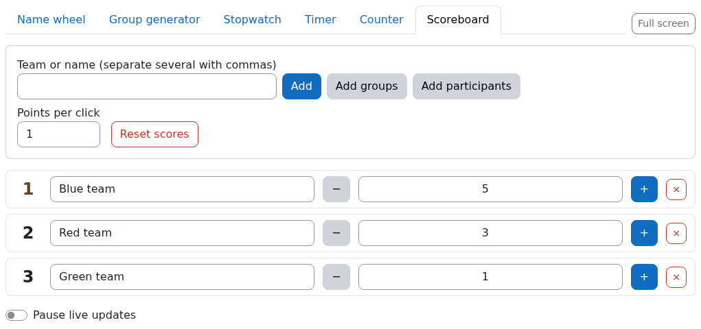

# Classroom Toolbox (mod_classroomtoolbox)

A Moodle activity with classroom tools shown as tabs. Teachers add it once and switch on the tools they want.


## Tools

Each tool is a tab. Teachers choose which tools are on in the activity settings (Tools). With only one tool on, there is no tab bar. Every tool has a **Full screen** button for projecting it onto a classroom screen.

| Tool | What it does |
|---|---|
| **Name wheel** | Spin a wheel of student names; remove the winner or keep them. |
| **Group generator** | Split the class into random groups, by number of groups or people per group. |
| **Stopwatch** | Start, stop, lap and reset, with a lap list. |
| **Timer** | Countdown timers with preset buttons, a sound and a flash at the end, and up to four timers at once. |
| **Counter** | Up to eight named counters with plus, minus and reset. |
| **Scoreboard** | Teams or names with points, ranked live; teachers give points, students watch. |


### Name wheel

- **Click the wheel** (or the centre button, or press Enter/Space on it) to spin. A random name is chosen with the browser's crypto random source.
- **Sound**: soft ticks as the wheel passes each name and a chime when one is picked. The **Sound** switch turns it off; the choice is remembered in the browser and also mutes the timer alarm.
- A pop-up announces the winner and offers **Remove from wheel** or **Keep on wheel**.
- The wheel is filled from the course participants (students by default). In group mode, tick any combination of groups to combine them on one wheel. Extra names can be typed in the settings.
- Pick one of five colour schemes (Classic, Ocean, Sunset, Pastel, High contrast); it also colours the group generator's cards.
- The names box beside the wheel can be edited live; **Shuffle**, **Sort A-Z** and **Reset wheel** are available.
- Removing a name only changes the current page; reloading restores the full list.

### Group generator


- Starts from the same people as the wheel (course participants you are allowed to see, plus typed names); edit the list freely.
- Choose **Number of groups** or **People per group**, then **Generate groups**. Groups differ in size by at most one person, and the shuffle uses the browser's crypto random source. Each group gets its own colour from the activity's colour scheme.
- In group mode, tick which Moodle groups to include.
- **Copy groups** puts the result on the clipboard as plain text.

### Stopwatch

Start, stop, **Lap** and reset. Time comes from timestamps, so it stays accurate if the tab is in the background.

### Timer


- Preset buttons (set per activity, default 1, 3, 5, 10 minutes), or type minutes and seconds.
- A beep (switch it off with **Sound**) and a flashing card when time is up; the end is also announced to screen readers.
- Up to four timers at once. The browser is asked to keep the screen on while a timer runs.

### Counter

Up to eight counters. Rename each one, then raise, lower or reset it.

### Scoreboard



- A teacher adds teams or names (several at once, separated by commas), or copies in the Moodle **groups** or the **participants** with one click. Names are copied as plain text and are **not linked to user accounts**.
- **+** and **−** give or take points; **Points per click** sets the step. You can also type an exact score or rename an entry. **Reset scores** asks first and keeps the entries.
- The board is ranked by points (ties share a place) and re-orders with a short animation. Use **Full screen** to project it.
- Students see the same ranked board, read-only. It refreshes itself every few seconds while the tab is open and visible, so a teacher's change appears without reloading.
- Who may change it: the capability `mod/classroomtoolbox:managescores` (teachers, non-editing teachers and managers by default). Everyone who can view the toolbox can read it.
- Scores are saved in the database, so they survive reloads and are included in backup, restore and duplication. Up to 100 entries per scoreboard. Every change is logged as a `scoreboard_changed` event.

### Accessibility

Every tool is keyboard operable and announces results to screen readers. The wheel prints readable text on every wedge (at least 4.5:1) and offers a 7:1 High contrast scheme. Animations stop for people who ask their system for reduced motion. The scoreboard has a **Pause live updates** switch. An axe-core Behat feature (`tests/behat/accessibility.feature`) checks every tool.

### Privacy

Spins, groups, laps, timers and counts live only in the open page. The scoreboard stores the labels and points a teacher types in; they are plain text, never tied to a user account, and are removed when the entry or the activity is deleted. The plugin keeps no data linked to a user account, and its privacy provider declares the free text it stores so that it shows in Moodle's privacy registry. Note that "Add participants" copies enrolled users' names onto the scoreboard as plain text: after that they are not tied to the account, so deleting a user does not remove them. Remove the entry (or delete the activity) to erase them, and do not copy in more personal data than you need.

## Install

Copy this folder to `mod/classroomtoolbox` (Moodle 5.0 - 5.3: `public/mod/classroomtoolbox`) and run the Moodle upgrade, or upload the zip under Site administration > Plugins > Install plugins. Add "Classroom Toolbox" to a course as an activity.

### Coming from Name wheel (`mod_namewheel`)

This is a new plugin, so Moodle does not upgrade the old one. Install this plugin next to it, then run (dry run first):

```
php mod/classroomtoolbox/cli/migrate_from_namewheel.php --dry-run
php mod/classroomtoolbox/cli/migrate_from_namewheel.php
```

Back up the site first. After checking the activities, uninstall the old plugin.

## Capabilities

- `mod/classroomtoolbox:addinstance` - add a toolbox (teachers, managers).
- `mod/classroomtoolbox:view` - see the toolbox.
- `mod/classroomtoolbox:appear` - appear as a name on the wheel (students by default).
- `mod/classroomtoolbox:managescores` - change the scoreboard (teachers, non-editing teachers, managers).

## Licence

GNU GPL v3 or later.
